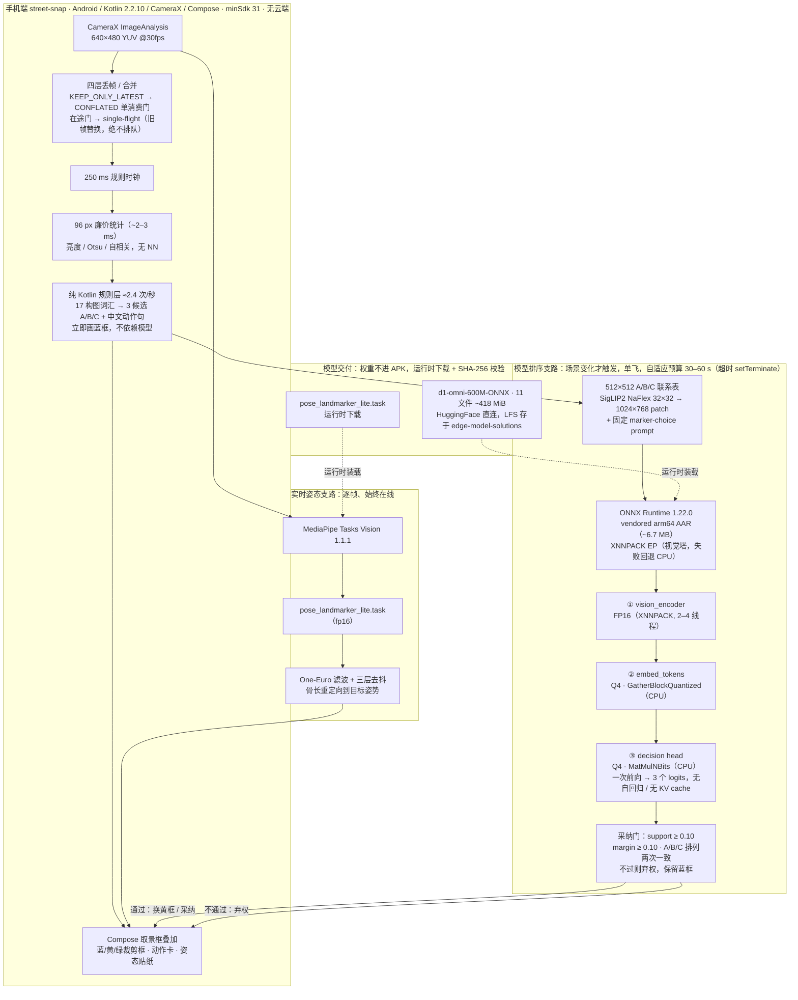

# Inference Engineering

端侧与边缘推理的工程研究仓：拆解单芯片上的推理链路，测量时间与内存的实际分布，检验云端推理技术在设备侧的成立条件。

Engineering research for inference on a single SoC: where the time goes, what the memory costs, and which cloud-era techniques survive device constraints. The first workload is the in-camera composition and pose inference in [`street-snap`](https://github.com/light-witness-lab/street-snap).

Evidence levels used everywhere: `verified` (measured on named hardware) · `loaded-only` (runs on emulator/desktop) · `not-verified`. Emulator numbers are never extrapolated to a real SoC.

## 推理技术架构：现在怎么跑起来，下一步去哪 / How inference runs today, and what's next

下图是 [`street-snap`](https://github.com/light-witness-lab/street-snap) v1 冻结基线的端侧推理链路：**纯本地、无云端**，两个推理框架各管一条支路。详细十阶段见 [composition pipeline v1](docs/on-device-composition-pipeline-v1.md)，600 M 模型的三次会话拆解见 [d1-omni case](docs/case-d1-omni-on-device.md)。

The diagram below is the frozen v1 on-device pipeline: fully local, two runtimes on two paths — MediaPipe for always-on pose, ONNX Runtime for a sparse one-shot ranking. Stage-by-stage detail lives in [pipeline v1](docs/on-device-composition-pipeline-v1.md).

读图三句话：

- **两个速率**：规则层（~2.4 次/秒）和姿态（逐帧）是廉价、始终在线的支路；600 M VLM 是稀疏触发、单飞、带 30–60 s 预算的排序支路，只在规则层给的 A/B/C 之间选一个或弃权。
- **框架 → 模型**：`MediaPipe Tasks Vision 1.1.1 → pose_landmarker_lite`；`ONNX Runtime 1.22.0 → d1-omni-600M 的三张 ONNX 图`（vision FP16 → embeddings Q4 → decision Q4）。
- 当前所有时延数字来自 QEMU 软渲模拟器（`loaded-only`），**不外推荣耀 Vs3**。

### 现有技术栈 vs 期望技术栈 / Today's stack vs target stack

| 层 | 现有（v1 冻结基线，已跑通） | 期望（v2 backlog，按"先测量"排序） |
| --- | --- | --- |
| 测量基线 | 模拟器 QEMU 软渲 `loaded-only`；App 内 `rank_vision_ms` / `rank_decision_ms` / `rank_total_ms` 滚动记录 | **V2-1 荣耀 Vs3 真机分段 p50/p95 + V2-7 热稳态 / 焦耳每排序**——其他一切优化的前置门，现状 blocked: needs device |
| 推理框架 | **ONNX Runtime 1.22.0**（vendored arm64 AAR，XNNPACK EP → CPU 回退，`ALL_OPT`）；**MediaPipe Tasks Vision 1.1.1**（姿态） | **V2-4 NNAPI / NPU EP 探查**（exploratory）：`MatMulNBits` / `GatherBlockQuantized` 预计无法 delegate，必须逐算子审计回退 |
| 模型 | **d1-omni-600M** 三图：vision FP16 + embeddings Q4 + decision Q4，双向决策头单次前向；pose landmarker lite fp16 | **V2-3 INT8 视觉塔**（疑似最大稳态收益，需量化校准 + gate-accuracy 检验）；**V2-2 视觉输入 512→384**（桌面 probe 0.50×、偏差指标通过，待真机）；**V2-8** 可能的更小 gate-keeper 模型 |
| 调度与线程 | 四层丢帧、single-flight、自适应预算 `clamp(elapsed·1.5+2s, 30–60s)`、冷却 3–15 s；视觉塔 2–4 线程 | **V2-5** Q4 两遍的线程放置 / 大核亲和 A/B；**V2-6** 裁剪 ~180 ms 帧准备地板，抬高规则层速率上限 |
| 工作负载形状 | 生成式 → 决策式重塑：无自回归、无 KV cache、无输出解析；规则层先跑，模型只排序或弃权 | **V2-8 级联价值实测**：在独立人工标注照片集上量化模型真实改变规则选择的频率，决定更稀疏触发还是小模型门 |

v2 每项都要求带 before/after 数据、以 v1.x amendment 形式落档；没有真机测量，任何内核 / 量化改动都不宣称成立。

## Field notes — what was built and what came out

| Note | Result | Status |
| --- | --- | --- |
| [Case: running a 600 M VLM on a phone CPU](docs/case-d1-omni-on-device.md) | A bidirectional decision head replaces autoregression: one forward pass, three logits, no KV cache, no output parsing. Three sessions (vision FP16/XNNPACK, embeddings + decision Q4). At 540×1170 a ranking takes ≈16–22 s; 1080×2340 frequently hits the 30 s budget and correctly times out. Adaptive budget `clamp(elapsed·1.5 + 2 s, 30–60 s)`. Background session warm-up applied 2026-10-20; INT8 vision tower queued pending calibration. | loaded-only (software-rendered emulator) |
| [CPU inference playbook](docs/on-device-cpu-inference-playbook.md) | Portable checklist ordered by leverage: reshape the workload before tuning kernels (generative→decision, single-pass candidate sheets, cheap always-on first stage), bounded self-limiting latency, drop-don't-queue scheduling, quantization/operator coverage, threading, warm-up, measure on the target device. | engineering checklist |
| [Composition pipeline v1 (frozen baseline)](docs/on-device-composition-pipeline-v1.md) | End-to-end shipping baseline: four frame-drop/coalescing layers, a pure-Kotlin rule layer at ≈2.4 evaluations/s drawing the guide immediately, one contact-sheet forward on the 600 M model, margin + permutation adoption gates. v2 optimization backlog itemized with evidence requirements; nothing in v2 has shipped. | loaded-only |
| [Pose coaching: filtering and retargeting](docs/on-device-pose-overlay-techniques.md) | One-Euro filtering on irregular live-stream cadence with visibility gating and 0.35 s hold-through, three-layer presence/pose debounce, bone-length retargeting of the target figure onto the observed body. | experimental (synthetic-geometry probes) |
| [Single-node P/D disaggregation review](docs/single-node-pd/README.md) | Does prefill/decode disaggregation survive a single host (M1 Max, 2026-11-01)? Ratio tuning (1P:2D) only works with independent resource pools; on one shared GPU it replicates weights and loses statistical multiplexing. Three falsifiable hypotheses (CPU/P vs GPU/D split is the credible one), 12 options reviewed (llama.cpp slot handoff is the lead), E0–E4 measurement plan. | not-verified (review only) |

## Goal and current gap

- **Goal:** content-adaptive understanding over a continuously analyzing viewfinder.
- **Today:** gated decisions at 1–3 per second; the model only picks between rule-layer candidates A/B/C or abstains. Continuous analysis is blocked by per-ranking latency (≈16–22 s on the emulator at 540×1170).
- **Next gate:** segmented p50/p95 latency and thermal-steady-state measurement on the Honor Vs3, then the INT8 vision tower with a gate-accuracy check. The executable benchmark protocol lives in the sibling repo [`edge-model-solutions/benchmarks/inference-perf`](https://github.com/light-witness-lab/edge-model-solutions/tree/main/benchmarks/inference-perf).

## Principles

- **Measure, don't assume.** A kernel setting ships only after on-device measurement.
- **Reshape before optimizing.** Decision outputs, shared-prefix single passes, and cheap first stages beat thread/quantization tuning; see the playbook's section 0.
- **Bound the latency.** Drop stale frames, never queue them; every slow path must degrade to a usable preview.
- **Separate facts from hypotheses.** Failed experiments and inapplicable cloud techniques are documented as such (case study §8 lists the cloud concepts that do not apply to a zero-token workload).
- **Keep it reproducible.** Record hardware, OS, runtime, revision, quantization, and the raw numbers.
